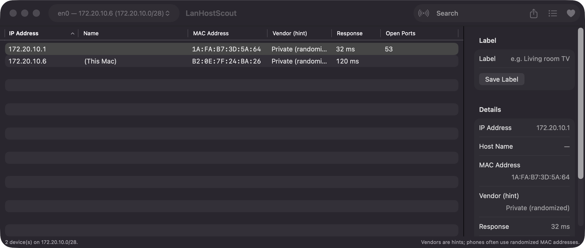
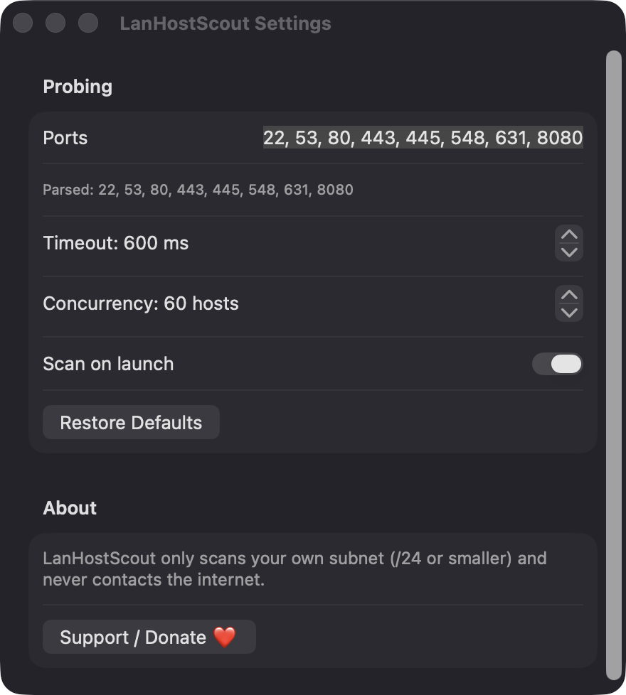
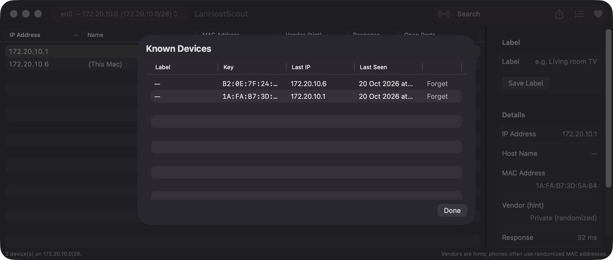

# LanHostScout

**🌐 Website:** [turhe123.github.io/lan-host-scout](https://turhe123.github.io/lan-host-scout/)

Scan your local network and list every device with its IP, name, MAC address, vendor hint and open common ports.


## Why

LanHostScout is a free, open-source, 100% native, backend-free alternative to paid utilities in the *Developer & Network* category. It was inspired by tools such as LanScan ($4.99 one-time), which show how common the need to "find out what is on my network" really is. Everything runs on your Mac, using only Apple frameworks.

## Features

- **Subnet sweep** of the selected interface, using bounded-concurrency TCP probes (default 60 hosts at once). A successful connection or a "connection refused" both count as a sign of life.
- **Interface picker** built from `getifaddrs`, defaulting to the system's primary interface. Link-local (169.254/16) addresses are skipped.
- **Safety limits:** scans are limited to /24 or smaller subnets (254 addresses), and VPN/tunnel interfaces (`utun`, `ipsec`, `ppp`, `tun`, `tap`, point-to-point, …) are refused with a message.
- **Merged results** from three sources, keyed by IP: probes, the system ARP cache (read via a `sysctl` routing-table query), and Bonjour/mDNS service discovery (`_http`, `_ssh`, `_smb`, `_airplay`, `_ipp`, `_googlecast`, `_hap` and others).
- **Table columns:** IP address, name (Bonjour or reverse DNS via `getnameinfo`), MAC address, vendor hint, response time and open ports. All columns are sortable.
- **Vendor hints** from a small built-in table of common MAC prefixes. Randomized (locally administered) addresses are labelled "Private (randomized)". These are hints only and can be wrong.
- **Default ports:** 22, 53, 80, 443, 445, 548, 631, 8080 (editable, up to 32 ports).
- **Details sidebar** with full device info, which sources saw the device, and a **Label** field.
- **Known Devices:** labels are stored as JSON in `~/Library/Application Support/LanHostScout/known-devices.json`. Devices not seen in earlier scans are tagged **NEW**. You can review and forget known devices.
- **Search** across IP, name, MAC, vendor, ports and label.
- **Copy** a row (context menu or ⌘C) and **export to CSV** (all rows or a selection).
- **Settings:** port list, timeout (100–5000 ms), concurrency (1–256), and scan on launch.
- **Stop** a scan at any time; pending connections are cancelled.
- **Warnings:** a banner with an *Open System Settings* button if Local Network access looks denied, and a clear message when no local network is found.
- **Shortcuts:** ⌘R rescan, ⌘E export CSV, ⌘F search, ⌘. stop.

## Screenshots

<p align="center"></p>

<p align="center"><em>A finished scan of the local subnet lists each device&#x27;s IP, MAC address, vendor hint, response time and open ports, with full details for the selected device in the sidebar.</em></p>

<p align="center"></p>

<p align="center"><em>Settings let you edit the probed ports, timeout and concurrency, and choose whether to scan on launch.</em></p>

<p align="center"></p>

<p align="center"><em>The Known Devices sheet lists every device seen before, with its label, last IP and last-seen time, and lets you forget entries.</em></p>

## Install

1. Download `LanHostScout-macOS.zip` from the [latest release](https://github.com/turhe123/lan-host-scout/releases/latest).
2. Unzip it and move `LanHostScout.app` to `/Applications`.
3. Because the app is open source and not notarized, run:

   ```bash
   xattr -cr /Applications/LanHostScout.app
   ```

4. Right-click the app and choose **Open** the first time.

## Build from source

Requires macOS 14+ and Xcode with Swift 5.9+.

```bash
brew install xcodegen
xcodegen generate
xcodebuild -project LanHostScout.xcodeproj -scheme LanHostScout -configuration Release -derivedDataPath ./build build
```

The app is produced at `build/Build/Products/Release/LanHostScout.app`.

## Permissions

- **Local Network** (the only one the app uses): macOS asks on first launch. LanHostScout needs it to probe addresses on your subnet and to browse Bonjour services. If you deny it, most devices cannot be reached, and the app shows a banner linking to System Settings.
- **Accessibility, Screen Recording, Microphone, Camera, Contacts, etc.:** not requested, and nothing in the code uses them.
- The ARP cache is read with a normal-user `sysctl` query, so no admin rights are needed.

## Built with AI

LanHostScout was written by [Claude Code](https://claude.com/claude-code) inside an automated pipeline, from a plain-English spec. No code, binaries or assets from any commercial app were used; it is a clean-room reimplementation of a feature set, not a copy.

What that means in practice:

- The full source is in this repo under the MIT license. Read it before you run it.
- Network access is used only for the feature itself (see Sources). No analytics, no third-party dependencies. Only Apple frameworks.
- Ad-hoc signed and not notarized, which is why Gatekeeper warns on first launch.
- It has had less human review than a hand-written app. Bug reports and pull requests are welcome.

## Support ❤️

If LanHostScout is useful to you, you can support its development:

[Support Or (Leo) Davidai ❤️](https://ko-fi.com/leodavidai)

The app also has a **Support / Donate ❤️** button in the toolbar, Settings and the Help menu.

## License

MIT © Or Davidai Bachar
